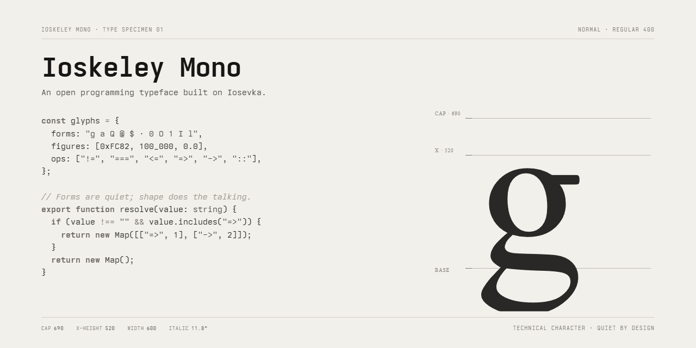
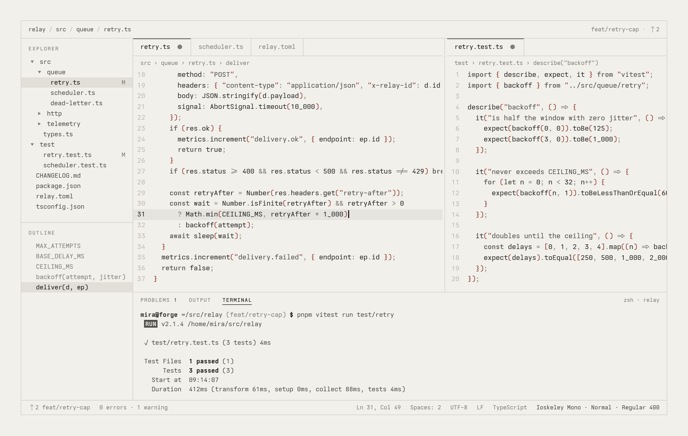
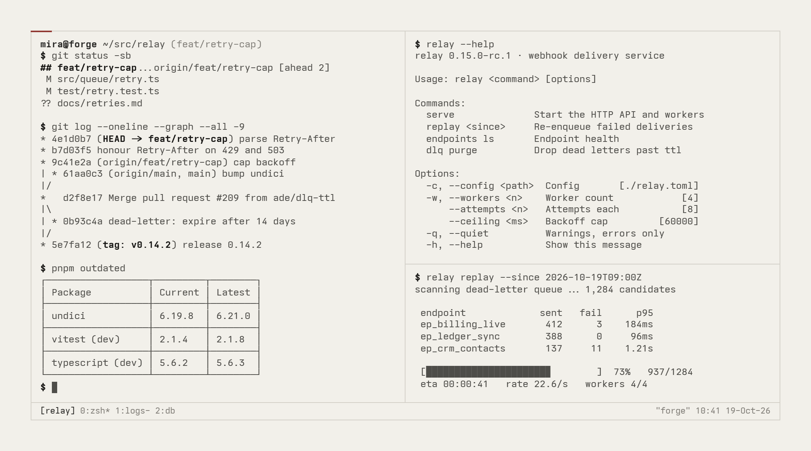

<p align="center">
  <picture>
    <source media="(prefers-color-scheme: dark)" srcset="assets/SocialPreview.png">
    
  </picture>
</p>

<h1 align="center">Ioskeley Mono</h1>

<p align="center">
  An open programming typeface built on Iosevka.<br>
  Compact, geometric, and tuned for editors and terminals.
</p>

<p align="center">
  <a href="https://github.com/ahatem/IoskeleyMono/releases/latest"></a>
  <a href="https://github.com/ahatem/IoskeleyMono/releases"></a>
  <a href="./LICENSE"></a>
  <a href="https://github.com/sponsors/ahatem"></a>
</p>

<p align="center">
  <a href="https://ahatem.github.io/IoskeleyMono/"><strong>Live Showcase</strong></a>
  &nbsp;·&nbsp;
  <a href="#downloads"><strong>Download</strong></a>
  &nbsp;·&nbsp;
  <a href="#installation">Install</a>
  &nbsp;·&nbsp;
  <a href="#why-i-built-ioskeley-mono">Story</a>
</p>

<br>

Ioskeley Mono is a free, open-source programming typeface: ten weights, two
widths, upright and italic, in three families for editors, terminals, and apps
that cannot turn ligatures off. It is built for long days of reading code, with
technical character and no visual noise.

<p align="center">
  <a href="https://ahatem.github.io/IoskeleyMono/#workbench">
    <picture>
      <source media="(prefers-color-scheme: dark)" srcset="assets/readme/Workbench.png">
      
    </picture>
  </a>
</p>

<p align="center"><sub>
  Explorer, editors, terminal and status bar: one typeface at three sizes.
  The <a href="https://ahatem.github.io/IoskeleyMono/">Live Showcase</a> follows a
  full working day in Ioskeley (editor, terminal, review, logs, queries and docs)
  and has a live specimen you can type into.
</sub></p>

## Why I Built Ioskeley Mono

Berkeley Mono was the first typeface that made me think seriously about how much
character could live in a compact programming font. I admired its geometry and
technical presence, but it was a commercial font I could not justify buying at
the time. I wanted to explore that kind of carefully made type, and make the
result freely available.

Finding [Iosevka](https://github.com/be5invis/Iosevka) gave me a way to do that.
I generated and tested more than a hundred builds, adjusting forms, spacing and
proportions, then trying each iteration in real editors and terminals. That
process began with a reference in mind; the accumulated decisions gradually
became Ioskeley.

Ioskeley is now its own open typeface, not a clone or a specification match.
Berkeley Mono remains part of its history, while Iosevka is the foundation that
made the experiment possible.

## Choose Your Ioskeley

Every family has the same 40 styles: ten weights from Thin to Black, Normal and
SemiCondensed widths, upright and italic.

| Family | Ligatures | Best for |
|---|:---:|---|
| **Standard** · `Ioskeley Mono` | Yes | General editor use. |
| **Term** · `Ioskeley Mono Term` | Yes | Terminals; arrows and box drawing tuned to the cell. |
| **NL** · `Ioskeley Mono NL` | No | Apps that cannot disable ligatures, or when you prefer none. |

Two widths, both in every desktop and Nerd Font archive:

- **Normal** (600 units): the standard balance of spacing and readability.
- **SemiCondensed** (540 units, 90% of Normal): more characters on a line.

NL keeps ordinary character shaping; it only drops the programming ligatures.

### Nerd Font or Nerd Font Mono?

Starting with 2.2.0, every Nerd Font archive contains both patched variants:

- **Nerd Font (NF):** ordinary Nerd Fonts geometry with larger icons. A good
  starting point for most setups that want icons; some icons may extend beyond
  one cell.
- **Nerd Font Mono (NFM):** strict one-cell advances for applications or font
  pickers that require true monospace behavior.

Neither is universally better. Choose the geometry your application expects.

<p align="center">
  <a href="https://ahatem.github.io/IoskeleyMono/#terminal">
    <picture>
      <source media="(prefers-color-scheme: dark)" srcset="assets/readme/Terminal.png">
      
    </picture>
  </a>
</p>

<p align="center"><sub>
  Box drawing meets at a line height of exactly 1.25, where the font's own
  metrics put it. Shown in the Standard web build; Term tunes arrows and box
  drawing to the terminal cell.
</sub></p>

## Downloads

| Use | Archive |
|---|---|
| Standard · editor and general use | [`IoskeleyMono.zip`](https://github.com/ahatem/IoskeleyMono/releases/latest/download/IoskeleyMono.zip) |
| Standard · with Nerd Font icons | [`IoskeleyMono-NerdFont.zip`](https://github.com/ahatem/IoskeleyMono/releases/latest/download/IoskeleyMono-NerdFont.zip) |
| Term · terminal use | [`IoskeleyMono-Term.zip`](https://github.com/ahatem/IoskeleyMono/releases/latest/download/IoskeleyMono-Term.zip) |
| Term · with Nerd Font icons | [`IoskeleyMono-Term-NerdFont.zip`](https://github.com/ahatem/IoskeleyMono/releases/latest/download/IoskeleyMono-Term-NerdFont.zip) |
| NL · no programming ligatures | [`IoskeleyMono-NL.zip`](https://github.com/ahatem/IoskeleyMono/releases/latest/download/IoskeleyMono-NL.zip) |
| NL · with Nerd Font icons | [`IoskeleyMono-NL-NerdFont.zip`](https://github.com/ahatem/IoskeleyMono/releases/latest/download/IoskeleyMono-NL-NerdFont.zip) |
| Web · smaller WOFF2 subset | [`IoskeleyMono-Web.zip`](https://github.com/ahatem/IoskeleyMono/releases/latest/download/IoskeleyMono-Web.zip) |
| Web Full · desktop glyph repertoire | [`IoskeleyMono-Web-Full.zip`](https://github.com/ahatem/IoskeleyMono/releases/latest/download/IoskeleyMono-Web-Full.zip) |

> These links always serve the latest published release.

<details>
<summary><strong>Web fonts</strong></summary>

<br>

`IoskeleyMono-Web.zip` is a smaller WOFF2 subset for common Latin text,
punctuation, arrows, math, and box drawing. Use `IoskeleyMono-Web-Full.zip` when
your site needs the full desktop repertoire, including Greek, Cyrillic, and less
common symbols. Both archives use the same public filenames, so changing between
them does not require different `@font-face` rules.

```css
@font-face {
  font-family: "Ioskeley Mono";
  src: url("./IoskeleyMono-Regular.woff2") format("woff2");
  font-style: normal;
  font-weight: 400;
  font-display: swap;
}
```

Add the other weight/style faces your site uses. The web packages contain WOFF2
files only; browser hinting is not included.

</details>

## Installation

### Package Managers

These community packages may update on a different schedule from GitHub Releases.

| System | Package | Install |
|---|---|---|
| macOS | [Homebrew](https://formulae.brew.sh/cask/font-ioskeley-mono) | `brew install --cask font-ioskeley-mono` |
| macOS | [Homebrew](https://formulae.brew.sh/cask/font-ioskeley-mono-term-nerd-font) (Term Nerd Font) | `brew install --cask font-ioskeley-mono-term-nerd-font` |
| Nix / NixOS | [nixpkgs](https://github.com/NixOS/nixpkgs/tree/master/pkgs/data/fonts/ioskeley-mono) | `nix profile install nixpkgs#ioskeley-mono.normal` |
| Arch Linux | [AUR](https://aur.archlinux.org/packages/ttf-ioskeley-mono) | `ttf-ioskeley-mono` |
| Slackware | [SlackBuilds.org](https://slackbuilds.org/repository/15.0/system/IoskeleyMono/) | `IoskeleyMono` |

Thanks to [@zhimoe](https://github.com/zhimoe),
[@dave-atx](https://github.com/dave-atx),
[@ForsakenHarmony](https://github.com/ForsakenHarmony), and
[@frovere](https://github.com/frovere) for helping bring Ioskeley to Homebrew.

### Manual Installation

1. Download and unzip the family archive you want.
2. Choose **Normal** or **SemiCondensed**. For standard-density Windows/Linux
   displays, install from **Hinted**; for macOS or HiDPI displays, choose
   **Unhinted**. Nerd Font archives do not split into hinted/unhinted folders.
3. Install the `.ttf` files for your chosen width and rendering set:
   - **Windows:** right-click and choose **Install** (or **Install for all users**).
   - **macOS:** open the fonts in Font Book and choose **Install**.
   - **Linux:** copy them to `~/.local/share/fonts/IoskeleyMono/`, then run
     `fc-cache -fv`.

Restart open applications so they refresh their font lists.

### Editors and Terminals

Use the family name matching the package you installed: `Ioskeley Mono`,
`Ioskeley Mono Term`, or `Ioskeley Mono NL`. Patched families add a `Nerd Font`
or `Nerd Font Mono` suffix; select the full installed name in your font picker.

**VS Code / Cursor**

```json
{
  "editor.fontFamily": "'Ioskeley Mono', monospace",
  "editor.fontLigatures": true,
  "editor.fontWeight": "400",
  "editor.fontSize": 14.5,
  "editor.lineHeight": 1.55
}
```

For an app that cannot disable programming ligatures, install NL and use
`Ioskeley Mono NL`. For patched icons, select the NF or NFM family you installed.

**Ghostty**

```ini
font-family = Ioskeley Mono Term
font-size = 14
```

**Kitty**

```conf
font_family      Ioskeley Mono Term
bold_font        auto
italic_font      auto
bold_italic_font auto
font_size        14.0
```

## Type Details

Ioskeley is built from Iosevka, but it is not a stock Iosevka preset. Its
[build plan](./private-build-plans.toml) defines its glyph forms, widths, slopes,
spacing, and vertical metrics. The forms are chosen to be read, not noticed: a
single-storey `g`, dotted zero, open `6` and `9`, and programming punctuation that
stays distinct at small sizes.

| Metric | Value |
|---|---|
| Units per em | 1000 |
| Cap height | 690 |
| x-height | 520 |
| Advance | 600 Normal · 540 SemiCondensed |
| Italic angle | 11.8° |
| Weights | Thin 100 · ExtraLight 200 · Light 300 · SemiLight 350 · Regular 400 · Medium 500 · SemiBold 600 · Bold 700 · ExtraBold 800 · Black 900 |

Where an application exposes OpenType features:

| Feature | Effect |
|---|---|
| `calt` | Contextual programming ligatures in Standard and Term; NL omits them. |
| `zero` | Optional slashed zero; the default is dotted. |
| `dlig` | Discretionary ligatures, when supported by the shaping application. |
| `onum`, `frac` | Upstream old-style figures and fraction features, when supported. |

For example, VS Code can enable the slashed zero alongside its ligatures:

```jsonc
"editor.fontLigatures": "'calt', 'zero'"
```

The project's visual language follows the typeface: monochrome and
typography-first, with one sparing accent. See the
[visual identity reference](./docs/VISUAL_IDENTITY.md).

## Origins

Berkeley Mono / TX-02 inspired the first experiment, but it is a reference in
Ioskeley's history, not its specification. Iosevka made the exploration
possible; repeated tuning shaped a distinct set of proportions and forms.

<details>
<summary><strong>Historical character, overlay, and code studies</strong></summary>

<br>

These studies document the project's origins. They are not claims of visual
equivalence and do not define the current design direction. TX-02 is a commercial
typeface; its files are not included or distributed here.

**01 · Character forms**

<picture>
  <source media="(prefers-color-scheme: dark)" srcset="assets/Origins-01-Character-Forms.png">
  
</picture>

**02 · Overlay study**

<picture>
  <source media="(prefers-color-scheme: dark)" srcset="assets/Origins-02-Overlay-Study.png">
  
</picture>

**03 · Code texture**

<picture>
  <source media="(prefers-color-scheme: dark)" srcset="assets/Origins-03-Code-Texture.png">
  
</picture>

</details>

## Build from Source

The [build, validation, and release guide](./docs/BUILD_AND_RELEASE.md) covers
prerequisites, reproducible builds, validation, packaging, and the publishing
boundary. The [`private-build-plans.toml`](./private-build-plans.toml) file is
the source for glyph and metric configuration; tagged builds use the pinned
Iosevka source.

## Contributing

Bug reports, glyph refinement proposals, documentation fixes, and build-plan
improvements are welcome.

- Review the build plan before proposing a glyph or metric adjustment.
- Use [GitHub Issues](https://github.com/ahatem/IoskeleyMono/issues) for
  reproducible problems and design suggestions.
- Send a pull request when you have a tested change.

## Support

Ioskeley is free, and every style is in the open release; there is no paid
edition and nothing held back.

If it has become part of how you work, you can help keep it maintained through
[GitHub Sponsors](https://github.com/sponsors/ahatem). Sponsorship goes into the
quiet work behind each release: testing builds across editors, terminals and
platforms, keeping the packages, showcase and documentation in order, and
continuing to refine the forms.

A star, a careful bug report, or a screenshot of your setup helps too.

## License and Acknowledgments

Ioskeley Mono is released under the [SIL Open Font License 1.1](./LICENSE),
which permits personal and commercial use subject to its terms. Ioskeley is
built with [Iosevka](https://github.com/be5invis/Iosevka), created by Belleve
Invis and its contributors. The icon variants use the
[Nerd Fonts](https://github.com/ryanoasis/nerd-fonts) project; upstream projects
and assets remain subject to their own licenses.

Berkeley Mono is a commercial typeface by Neil Panchal at
[Berkeley Graphics](https://berkeleygraphics.com/typefaces/berkeley-mono/).
Ioskeley is independent and is not affiliated with or endorsed by Berkeley
Graphics. If the original design interests you, consider supporting its creator
through Berkeley Graphics.

**Author:** Ahmed Hatem <ahatem925@gmail.com>
