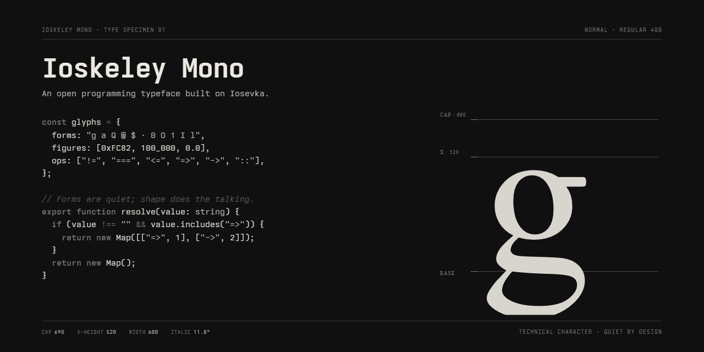
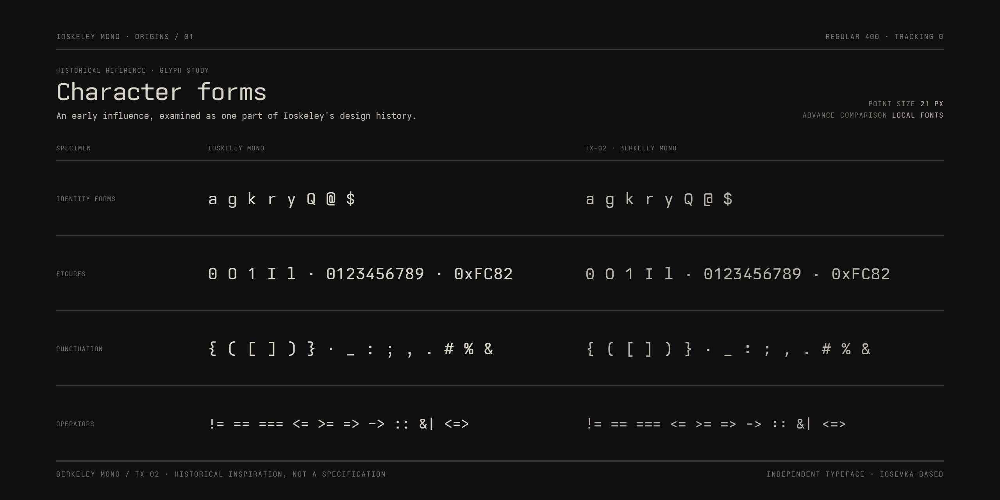
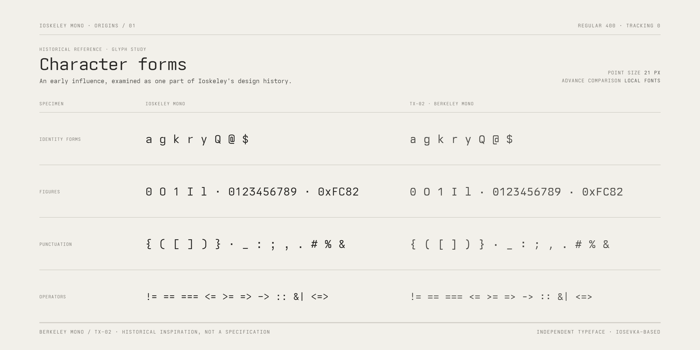
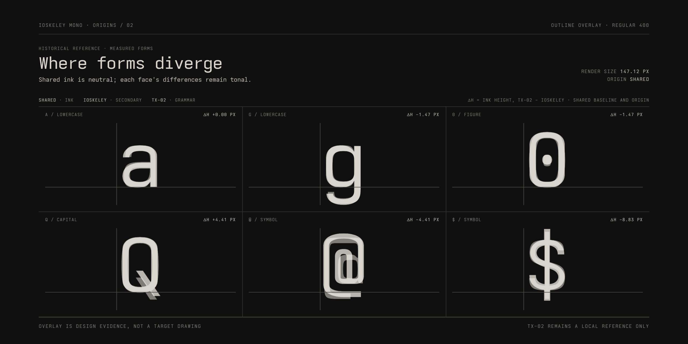
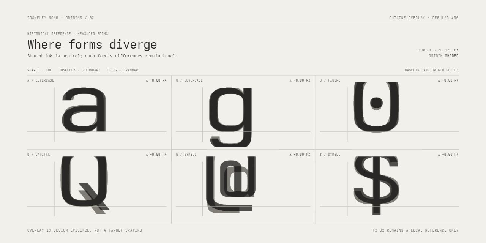
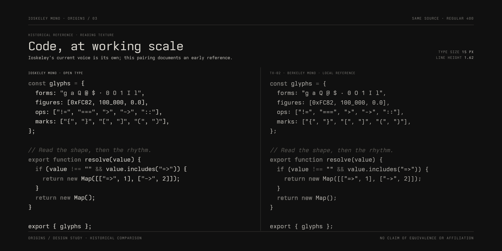
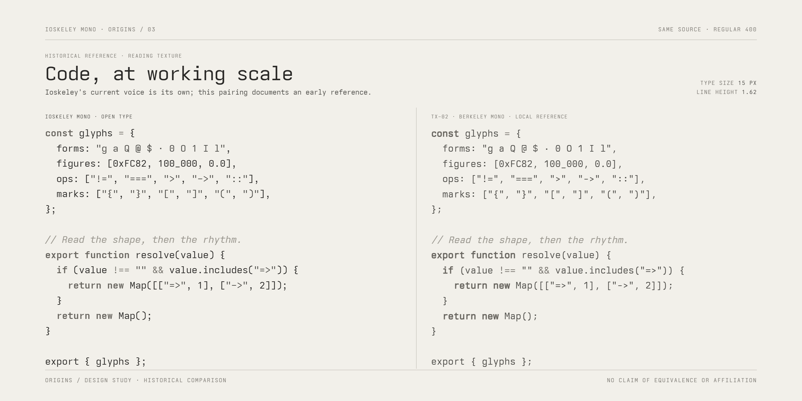

<p align="center">
  
</p>

# Ioskeley Mono

<p align="center">
  <strong>An open programming typeface built on Iosevka.</strong><br>
  Compact, geometric, and tuned for editors and terminals.<br>
  <em>Technical character without visual noise.</em>
</p>

<p align="center">
  <a href="https://github.com/ahatem/IoskeleyMono/releases/latest"></a>
  <a href="https://github.com/ahatem/IoskeleyMono/releases"></a>
  <a href="./LICENSE"></a>
</p>

<p align="center">
  <a href="https://github.com/ahatem/IoskeleyMono/releases/latest"><strong>Download</strong></a>
  &nbsp;·&nbsp;
  <a href="https://ahatem.github.io/IoskeleyMono/"><strong>Live Showcase</strong></a>
</p>

<p align="center">
  <a href="#why-i-built-ioskeley-mono">Story</a> ·
  <a href="#at-a-glance">At a glance</a> ·
  <a href="#choose-a-family">Families</a> ·
  <a href="#downloads">Downloads</a> ·
  <a href="#installation">Install</a> ·
  <a href="#build-from-source">Build</a>
</p>

## Why I Built Ioskeley Mono

Berkeley Mono was the first typeface that made me think seriously about how much
character could live in a compact programming font. I admired its geometry and
technical presence, but it was a commercial font I could not justify buying at
the time. I wanted to explore that kind of carefully made type, and make the
result freely available.

Finding [Iosevka](https://github.com/be5invis/Iosevka) gave me a way to do that.
I generated and tested more than a hundred builds, adjusting forms, spacing and
proportions, then trying each iteration in real editors and terminals. That
process began with a reference in mind; the accumulated decisions gradually
became Ioskeley.

Ioskeley is now its own open typeface, not a clone or a specification match.
Berkeley Mono remains part of its history, while Iosevka is the foundation that
made the experiment possible.

## At a Glance

- **40 static styles per family:** ten weights, two widths, upright and italic.
- **Three families:** Standard and Term include programming ligatures; NL does
  not.
- **Purposeful forms:** single-storey `g`, dotted zero, open `6` and `9`, and
  clearly differentiated programming punctuation.
- **Three Nerd Font archives:** each includes both NF and NFM variants in 2.2.0.
- **Two web packages:** a compact subset and Web Full.
- **Open source:** licensed under the SIL Open Font License 1.1.

## Design

Ioskeley is built from Iosevka, but it is not a stock Iosevka preset. Its
[build plan](./private-build-plans.toml) defines its glyph forms, widths, slopes,
spacing, and vertical metrics.

The design aims for **technical character without visual noise**: compact forms
that do not feel crushed, distinctive details that reward a closer look, and a
quiet rhythm for everyday use. The visual identity follows the same idea. It is
monochromatic and typography-first; hierarchy comes from the typeface, spacing,
weight, and luminance rather than a branding hue. See the concise
[visual identity reference](./docs/VISUAL_IDENTITY.md).

## Choose a Family

| Family | Ligatures | Best for |
|---|:---:|---|
| **Standard** — `Ioskeley Mono` | Yes | General editor use. |
| **Term** — `Ioskeley Mono Term` | Yes | Terminals; arrows and box-drawing forms are tuned for terminal rhythm. |
| **NL** — `Ioskeley Mono NL` | No | Apps where ligatures cannot be disabled, or when you prefer none. |

Standard and Term include programming ligatures. NL is the no-programming-
ligature family; it retains ordinary character shaping.

### Choose a Width

| Width | Advance | Choose it when |
|---|---:|---|
| **Normal** | 600 units | You want the standard balance of spacing and readability. |
| **SemiCondensed** | 540 units | You want more characters on a line; this is 90% of Normal. |

Both widths are included in desktop and Nerd Font packages.

### Nerd Font or Nerd Font Mono?

Every 2.2.0 Nerd Font archive contains both patched variants:

- **Nerd Font (NF):** ordinary Nerd Fonts geometry with larger icons. A good
  starting point for most setups that want icons; some icons may extend beyond
  one cell.
- **Nerd Font Mono (NFM):** strict one-cell advances for applications or font
  pickers that require true monospace behavior.

Neither is universally better. Choose the geometry your application expects.
The Standard, Term, and NL Nerd Font archives each contain NF and NFM.

## Downloads

The archives contain the styles for their family and, where applicable, both
widths. Nerd Font archives include both NF and NFM as described above.

| Use | Archive |
|---|---|
| Standard — editor / general use | [`IoskeleyMono.zip`](https://github.com/ahatem/IoskeleyMono/releases/latest/download/IoskeleyMono.zip) |
| Standard — with Nerd Font variants | [`IoskeleyMono-NerdFont.zip`](https://github.com/ahatem/IoskeleyMono/releases/latest/download/IoskeleyMono-NerdFont.zip) |
| Term — terminal use | [`IoskeleyMono-Term.zip`](https://github.com/ahatem/IoskeleyMono/releases/latest/download/IoskeleyMono-Term.zip) |
| Term — with Nerd Font variants | [`IoskeleyMono-Term-NerdFont.zip`](https://github.com/ahatem/IoskeleyMono/releases/latest/download/IoskeleyMono-Term-NerdFont.zip) |
| NL — no programming ligatures | [`IoskeleyMono-NL.zip`](https://github.com/ahatem/IoskeleyMono/releases/latest/download/IoskeleyMono-NL.zip) |
| NL — with Nerd Font variants | [`IoskeleyMono-NL-NerdFont.zip`](https://github.com/ahatem/IoskeleyMono/releases/latest/download/IoskeleyMono-NL-NerdFont.zip) |
| Web — smaller WOFF2 subset | [`IoskeleyMono-Web.zip`](https://github.com/ahatem/IoskeleyMono/releases/latest/download/IoskeleyMono-Web.zip) |
| Web Full — desktop glyph repertoire | [`IoskeleyMono-Web-Full.zip`](https://github.com/ahatem/IoskeleyMono/releases/latest/download/IoskeleyMono-Web-Full.zip) |

**Release timing:** this README documents the 2.2.0 product. The latest published
release is still v2.1.0, whose Nerd Font archives predate the NF/NFM split
described here. If you download before 2.2.0 is published, you will not receive
both of those variants. The links use GitHub's `/releases/latest/download/`
route: they serve published files now and will resolve to the 2.2.0 archives
after release. No unreleased 2.2.0 asset URLs are used.

### Web Fonts

`IoskeleyMono-Web.zip` is a smaller WOFF2 subset for common Latin text,
punctuation, arrows, math, and box drawing. Use `IoskeleyMono-Web-Full.zip` when
your site needs the full desktop repertoire, including Greek, Cyrillic, and less
common symbols. Both archives use the same public filenames, so changing between
them does not require different `@font-face` rules.

```css
@font-face {
  font-family: "Ioskeley Mono";
  src: url("./IoskeleyMono-Regular.woff2") format("woff2");
  font-style: normal;
  font-weight: 400;
  font-display: swap;
}
```

Add the other weight/style faces your site uses. The web packages contain WOFF2
files only; browser hinting is not included.

## Installation

### Package Managers

These community packages may update on a different schedule from GitHub Releases.

| System | Package | Install |
|---|---|---|
| macOS | [Homebrew](https://formulae.brew.sh/cask/font-ioskeley-mono) | `brew install --cask font-ioskeley-mono` |
| Nix / NixOS | [nixpkgs](https://github.com/NixOS/nixpkgs/tree/master/pkgs/data/fonts/ioskeley-mono) | `nix profile install nixpkgs#ioskeley-mono.normal` |
| Arch Linux | [AUR](https://aur.archlinux.org/packages/ttf-ioskeley-mono) | `ttf-ioskeley-mono` |
| Slackware | [SlackBuilds.org](https://slackbuilds.org/repository/15.0/system/IoskeleyMono/) | `IoskeleyMono` |

Thanks to [@zhimoe](https://github.com/zhimoe),
[@ForsakenHarmony](https://github.com/ForsakenHarmony), and
[@frovere](https://github.com/frovere) for helping bring Ioskeley to Homebrew.

### Manual Installation

1. Download and unzip the family archive you want.
2. Choose **Normal** or **SemiCondensed**. For standard-density Windows/Linux
   displays, install from **Hinted**; for macOS or HiDPI displays, choose
   **Unhinted**. Nerd Font archives do not split into hinted/unhinted folders.
3. Install the `.ttf` files for your chosen width and rendering set:
   - **Windows:** right-click and choose **Install** (or **Install for all users**).
   - **macOS:** open the fonts in Font Book and choose **Install**.
   - **Linux:** copy them to `~/.local/share/fonts/IoskeleyMono/`, then run
     `fc-cache -fv`.

Restart open applications so they refresh their font lists.

## Editor and Terminal Setup

Use the family name matching the package you installed. The principal families
are `Ioskeley Mono`, `Ioskeley Mono Term`, and `Ioskeley Mono NL`. Patched
families use the corresponding `Nerd Font` or `Nerd Font Mono` suffix; select the
full installed family name in your font picker.

### VS Code / Cursor

```json
{
  "editor.fontFamily": "'Ioskeley Mono', monospace",
  "editor.fontLigatures": true,
  "editor.fontWeight": "400",
  "editor.fontSize": 14.5,
  "editor.lineHeight": 1.55
}
```

For an app that cannot disable programming ligatures, install NL and use
`Ioskeley Mono NL`. For patched icons, select the NF or NFM family you installed.

### Terminals

Use the Term family for terminal-oriented spacing. For example, in Ghostty:

```ini
font-family = Ioskeley Mono Term
font-size = 14
```

In Kitty:

```conf
font_family      Ioskeley Mono Term
bold_font        auto
italic_font      auto
bold_italic_font auto
font_size        14.0
```

### OpenType Features

Where an application exposes these OpenType features:

| Feature | Effect |
|---|---|
| `calt` | Contextual programming ligatures in Standard and Term; NL omits them. |
| `zero` | Optional slashed zero; the default is dotted. |
| `dlig` | Discretionary ligatures, when supported by the shaping application. |
| `onum`, `frac` | Upstream old-style figures and fraction features, when supported. |

For example, VS Code can enable the slashed-zero feature with its ligatures:

```jsonc
"editor.fontLigatures": "'calt', 'zero'"
```

## Weights and Styles

Every family includes ten static weights in upright and italic styles. Each
weight is present in both Normal and SemiCondensed widths.

| Weight | CSS `font-weight` |
|---|---:|
| Thin | `100` |
| ExtraLight | `200` |
| Light | `300` |
| SemiLight | `350` |
| Regular | `400` |
| Medium | `500` |
| SemiBold | `600` |
| Bold | `700` |
| ExtraBold | `800` |
| Black | `900` |

## Origins & Design Evolution

Berkeley Mono / TX-02 inspired the first experiment, but it is a reference in
Ioskeley's history—not its specification. Iosevka made the exploration
possible; repeated tuning shaped a distinct set of proportions and forms.
Ioskeley's current visual identity stands on its own.

<details>
<summary><strong>View the historical character, overlay, and code studies</strong></summary>

These studies document the project's origins. They are not claims of visual
equivalence and do not define the current design direction. TX-02 is a commercial
typeface; its files are not included or distributed here.

### 01 · Character Forms





### 02 · Overlay Study





### 03 · Code Texture





</details>

## Build from Source

The [build, validation, and release guide](./docs/BUILD_AND_RELEASE.md) covers
prerequisites, reproducible builds, validation, packaging, and the publishing
boundary. The [`private-build-plans.toml`](./private-build-plans.toml) file is
the source for glyph and metric configuration; tagged builds use the pinned
Iosevka source.

## Contributing

Bug reports, glyph refinement proposals, documentation fixes, and build-plan
improvements are welcome.

- Review the build plan before proposing a glyph or metric adjustment.
- Use [GitHub Issues](https://github.com/ahatem/IoskeleyMono/issues) for
  reproducible problems and design suggestions.
- Send a pull request when you have a tested change.

## Support

The most useful support is often practical: star the repository, share a setup,
report a glyph or installation issue, or help improve the build plan and
documentation. Financial support is optional and does not unlock a separate
font version: [GitHub Sponsors](https://github.com/sponsors/ahatem) ·
[Buy Me a Coffee](https://www.buymeacoffee.com/ahmedhatem).

## License and Acknowledgments

Ioskeley Mono is released under the [SIL Open Font License 1.1](./LICENSE),
which permits personal and commercial use subject to its terms. Ioskeley is
built with [Iosevka](https://github.com/be5invis/Iosevka), created by Belleve
Invis and its contributors. The icon variants use the
[Nerd Fonts](https://github.com/ryanoasis/nerd-fonts) project; upstream projects
and assets remain subject to their own licenses.

Berkeley Mono is a commercial typeface by Neil Panchal at
[Berkeley Graphics](https://berkeleygraphics.com/typefaces/berkeley-mono/).
Ioskeley is independent and is not affiliated with or endorsed by Berkeley
Graphics. If the original design interests you, consider supporting its creator
through Berkeley Graphics.

**Author:** Ahmed Hatem <ahatem925@gmail.com>
